# Open PO Report Automation

Excel VBA automation that retrieves an open purchase order report from SAP, exports the result as an Excel file, and prepares an Outlook email with the report attached.

The inspected workbook is configured for a specific business area. Its worksheet label and email content contain organization-specific values, so the public repository should use a sanitized copy before publication.

## Project overview

The application reduces the repeated manual work involved in producing and distributing an open purchase order report:

1. The user enters a start date and end date in the workbook.
2. VBA connects to an already logged-in SAP GUI session.
3. SAP transaction `ME2N` is opened and a saved selection variant is applied.
4. The date range is entered and the report is exported as an `.xlsx` file.
5. Outlook is used to prepare a standardized email with the exported report attached.

The current macro displays the email for review. It does not send the message automatically.

## Business problem solved

Without automation, the user must repeatedly navigate SAP, apply the same report variant, enter dates, export the report, rename or locate the file, and create a standard email. This workbook turns that sequence into one repeatable button-driven process while keeping the final email under human review.

## Implemented features

- Cell-based date inputs for report start and end dates.
- One-click execution from the worksheet button assigned to `SAP_Final_Solution`.
- Connection to the first active SAP GUI connection and session.
- Navigation to SAP transaction `ME2N`.
- Selection of a configured saved variant.
- Population of the SAP document-date range from cells `B2` and `B3`.
- SAP report execution and spreadsheet export.
- Creation of `C:\TEMP` when the local folder does not exist.
- Date-based output filename in the form `<BUSINESS AREA> OPEN PO REPORT <end-date>.XLSX` in the source workbook.
- Outlook draft creation with subject, body, recipient fields, and the exported report attached.
- Manual review before sending because the macro uses Outlook `.Display`, not `.Send`.
- Early exit with a message if no active SAP session is found.

## Application workflow

```mermaid
flowchart LR
    A[Excel date inputs<br/>B2 and B3] --> B[Run Macro button]
    B --> C[Read dates and build filename]
    C --> D[Connect to active SAP GUI session]
    D --> E[Open ME2N and apply saved variant]
    E --> F[Enter document-date range]
    F --> G[Execute and export report]
    G --> H[Save XLSX to local temp folder]
    H --> I[Create Outlook draft]
    I --> J[Attach report and display for review]
```



### Inputs and outputs

| Item | Current implementation |
| --- | --- |
| Workbook input sheet | One visible sheet configured for the business area |
| Start date | `B2` |
| End date | `B3` |
| SAP transaction | `ME2N` |
| SAP saved variant | Configured in the source workbook; configuration-specific |
| Local output folder | `C:\TEMP` |
| Output format | Excel `.xlsx` |
| Email client | Microsoft Outlook desktop |
| Email action | Draft is displayed for user review; not sent automatically |

## Technical details

### Technology stack

- Microsoft Excel macro-enabled workbook (`.xlsm`).
- Visual Basic for Applications (VBA).
- SAP GUI Scripting through late-bound COM objects.
- Microsoft Outlook automation through late-bound COM objects.
- Windows local file system for report output.

### VBA project structure

The inspected VBA project contains:

- `Module1` with the public procedure `SAP_Final_Solution`.
- `Sheet1` for the worksheet named by the workbook; no worksheet event code was found.
- `ThisWorkbook`; no workbook event code was found.
- No UserForms.
- No additional standard modules or custom class modules.

### Excel workbook structure

- One visible worksheet.
- Used cell range: `A1:B3`.
- Row 1 contains the label and value headers.
- Rows 2 and 3 contain the date labels and values.
- One worksheet form button labeled `Run Macro`.
- No formulas, Excel tables, PivotTables, charts, named ranges, or external-link parts were found in the inspected package.

### Integration behavior

The VBA code uses SAP GUI control IDs to navigate the SAP screens and export the report. It also creates an Outlook mail item using `CreateObject("Outlook.Application")`. Because both integrations are late-bound, the VBA project does not require a checked reference to the SAP or Outlook object libraries, but the corresponding desktop applications and permissions are still required at runtime.

## Requirements

- Windows with desktop Microsoft Excel and VBA support.
- Permission to run macros according to the organization's Microsoft Office policy.
- SAP GUI for Windows with SAP GUI Scripting enabled on the client and, where required, on the SAP system.
- An active SAP logon session with authorization to run the configured report transaction and saved variant.
- Microsoft Outlook desktop with a usable profile if email drafting is required.
- Write access to the configured local output folder.

## Installation and setup

1. Download or clone the repository.
2. Use only the sanitized workbook intended for public sharing. Do not publish the original production workbook.
3. Open the `.xlsm` file in desktop Microsoft Excel. Excel may open downloaded files in Protected View or block macros because the file is untrusted. Follow the organization's approved trusted-location or file-unblocking process; do not disable macro security globally.
4. Confirm that the worksheet contains the expected date inputs in `B2` and `B3`.
5. Confirm that the SAP saved variant and transaction are valid for the target SAP environment.
6. Confirm that `C:\TEMP` is writable, or update the macro in a controlled internal copy if the output path has been parameterized.
7. Log in to SAP before running the macro.
8. Open Outlook if the email-draft step is required.

## Usage

1. Enter the required report start date in `B2`.
2. Enter the required report end date in `B3`.
3. Log in to SAP GUI and leave the required session active.
4. Click `Run Macro`.
5. Wait for SAP to complete the report export.
6. Review the Outlook draft and its attachment.
7. Verify the date range, report content, recipients, subject, and attachment before sending manually.

## Known limitations and operational risks

These are characteristics of the current implementation, not completed improvements:

- SAP GUI control paths are tightly coupled to the current SAP screen layout and transaction configuration.
- The saved variant name is hard-coded.
- The output folder and filename pattern are hard-coded.
- The macro does not validate that the start date is valid, that the end date is valid, or that the start date is before the end date.
- SAP and Outlook initialization use `On Error Resume Next`, which can hide connection or object-creation failures.
- The export is not explicitly verified by checking that the output file exists before Outlook attaches it.
- The macro assumes the first SAP connection and first SAP session are the correct ones.
- The email recipients, sender-on-behalf address, greeting, and business-area wording are hard-coded in the source workbook.
- The macro was inspected statically and was not executed against SAP or Outlook during documentation preparation.

## Security and publication checklist

Before uploading any file to GitHub:

- Remove or replace hard-coded recipient, CC, and sender-on-behalf addresses.
- Remove company names, plant or site names, internal mailbox names, and internal business wording unless publication is authorized.
- Remove or replace SAP transaction variants and internal configuration identifiers if they are not intended to be public.
- Remove personal author metadata and organization metadata from the workbook properties.
- Remove SharePoint, OneDrive, or other internal paths embedded in workbook metadata.
- Remove sample production dates and any report outputs that contain supplier, purchase order, material, price, or other business data.
- Do not publish generated `.xlsx` reports, email exports, or files from `C:\TEMP`.
- Test the sanitized copy with synthetic dates and non-production recipients.
- Use a digitally signed or organization-approved macro distribution process for internal deployment.

## Recommended repository structure

```text
open-po-report-automation/
├── README.md
├── LICENSE
├── .gitignore
├── workbook/
│   ├── OpenPO_Report_Automation_sanitized.xlsm
│   └── src/
│       └── Module1.bas
├── docs/
│   ├── architecture.md
│   ├── setup-notes.md
│   └── screenshots/
│       ├── input-sheet.png
│       ├── vba-project.png
│       ├── sap-selection.png
│       ├── export-dialog.png
│       └── outlook-draft.png
└── examples/
    └── sample-input-notes.md
```

### Files to upload

Recommended:

- `README.md`.
- A sanitized `.xlsm` workbook if redistribution is allowed.
- An exported, sanitized `Module1.bas` file for source visibility and review.
- Synthetic examples or screenshots with all business data redacted.
- Setup and architecture notes.

Do not upload the original workbook, production report exports, unredacted VBA source, internal email addresses, or internal storage paths.

## Suggested screenshots

Use screenshots that demonstrate the workflow without revealing production data:

1. Excel input sheet showing the two date fields and `Run Macro` button with synthetic dates.
2. VBA Project Explorer showing the small project structure.
3. SAP selection screen showing the date range and a redacted saved-variant field.
4. SAP export dialog showing a redacted output path.
5. Generated report file in a sanitized local folder.
6. Outlook draft showing a redacted recipient list and the attached report.

## Future improvements

The following are suggested improvements and are not implemented in the inspected workbook:

- Move the transaction, variant, output folder, email recipients, and message template to a protected configuration sheet.
- Add date validation and a clear start-date/end-date error message.
- Replace broad error suppression with structured error handling and an execution log.
- Check that SAP export completed and that the output file exists before creating the email draft.
- Use a user-specific temporary folder or a configurable output directory instead of a fixed `C:\TEMP` path.
- Add a confirmation step before creating the email draft and a clear completion message after export.
- Make the SAP session and connection selection explicit instead of always using the first child object.
- Add a test mode or mock integration for demonstrations that do not have SAP access.
- Digitally sign the VBA project for controlled internal deployment.

## Portfolio description

### GitHub profile

Excel VBA automation that connects to SAP GUI, runs a configured open purchase order report for a selected date range, exports the result to Excel, and prepares an Outlook email with the report attached. The project demonstrates Excel VBA, SAP GUI scripting, desktop automation, process standardization, and procurement operations knowledge.

### Resume bullet

Built an Excel VBA automation tool that integrates with SAP GUI to generate date-filtered open purchase order reports, export them to Excel, and prepare standardized Outlook communications, reducing repetitive procurement reporting steps and improving process consistency.

### LinkedIn or portfolio summary

Developed a desktop Excel VBA automation solution for procurement reporting. The tool reads a user-selected date range, drives SAP GUI to retrieve an open purchase order report, saves the output as an Excel file, and prepares a reviewable Outlook draft with the report attached.

## License and data note

Choose a license only after confirming that the code and workbook may be distributed publicly. The original workbook contains organization-specific metadata and hard-coded communication details, so it should be treated as an internal asset until sanitized and approved for release.


